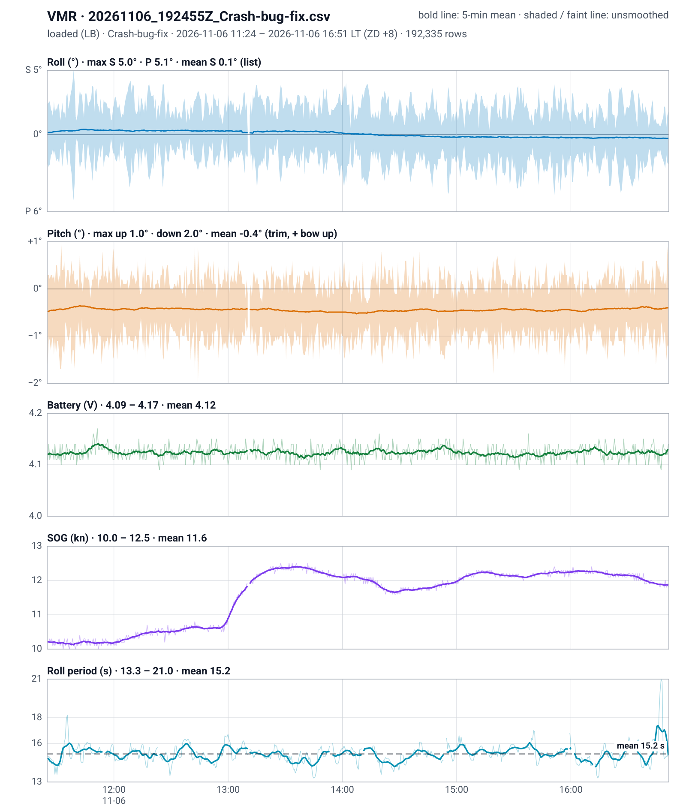
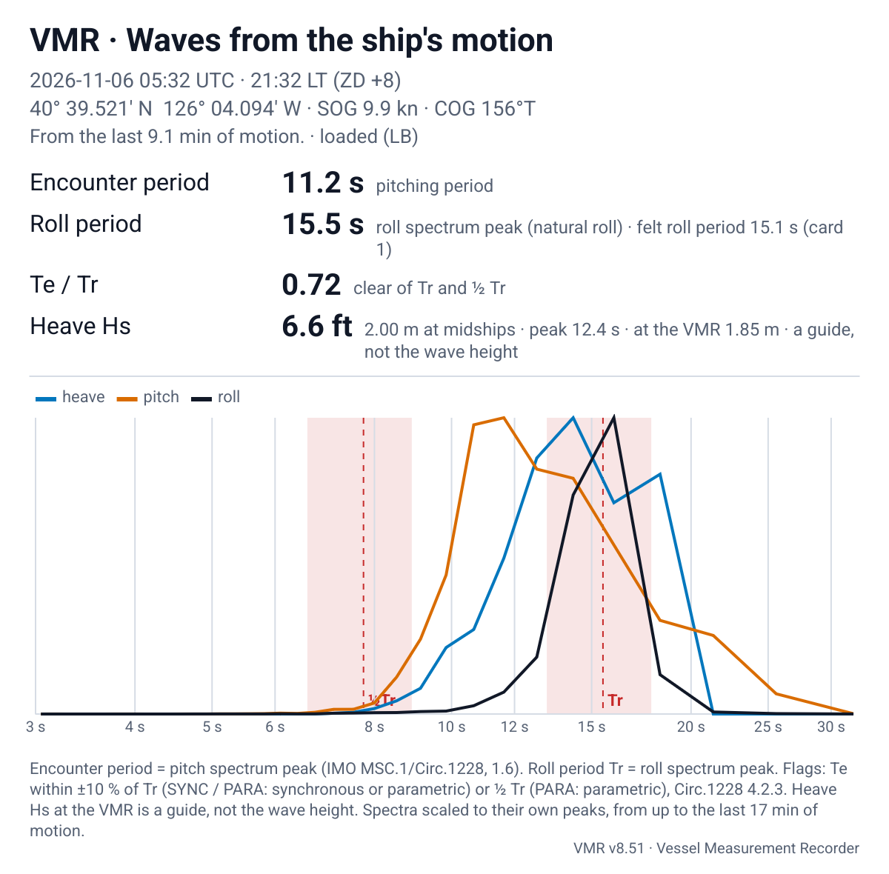
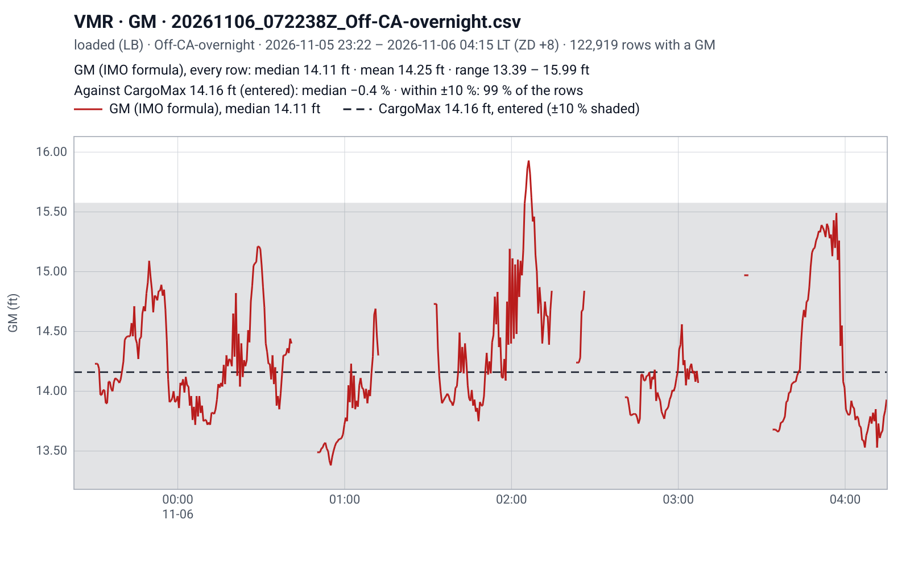
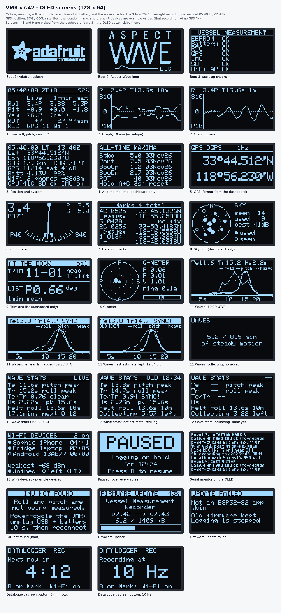
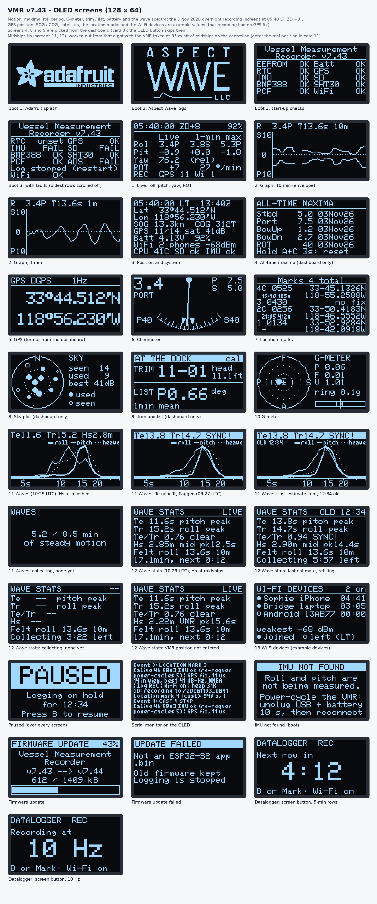
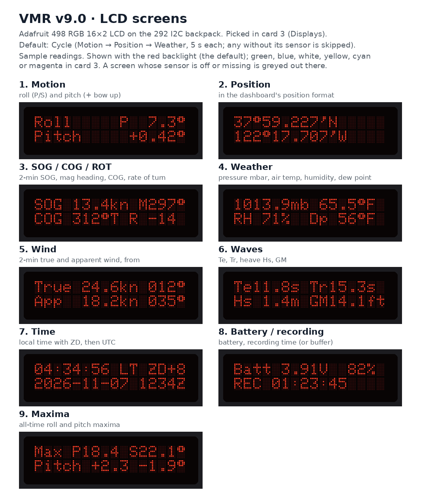

# Vessel Measurement Recorder
See overview PDF file for details. If you don't want to build your own, buy one from my buisness: [aspectwave.io/](https://www.aspectwave.io/store/p/vessel-measurement-recorder).

[placeholder image]
<!--  -->

## Example Figures / Plots from VMR

All of the following figures were generated onboard a VMR (it can generate a plot even while logging, and even of the file that is open and logging) and downloaded to my phone before being uploaded here.

### Roll, Pitch, SOG, Roll Period
<!--  -->

### Wave Spectrum
<!--  -->

### GM Estimate
<!--  -->

## OLED Screens
The following are the current screens that can be viewed on the OLED (v8.56). They are rotated through with a physical button on the VMR or via selection on the Wi-Fi dashboard. 

<!--  -->

## LCD Screens
The following are the current screens that can be viewed on the LCD (v9.x). By default, they are changed on the Wi-Fi Dashboard. If the system has no OLED (or it is disabled), they are changed with the screen button.

