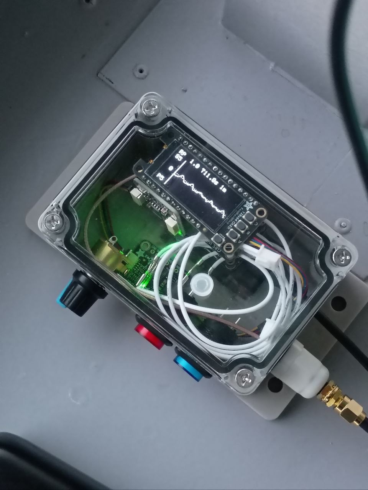

# Vessel-Measurement-Recorder
See overview PDF file for details. If you don't want to build your own, buy one from my buisness: [aspectwave.io/](aspectwave.io/).

[placeholder image]

### Example Figures / Plots from VMR
[image]

### Roll, Pitch, SOG, Roll Period
[image]

### Wave Spectrum
[image]

### GM Estimate
[image]

## OLED Screens

The following are the current screens that can be viewed on the OLED (v8.56). They are rotated through with a physical button on the VMR or via selection on the Wi-Fi dashboard.

[image]